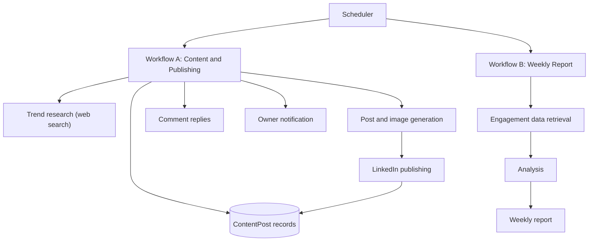
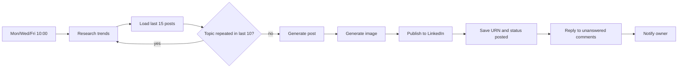

# AI LinkedIn Content & Engagement Automation Agent

> An AI system that researches trends, writes story-first LinkedIn posts in the author's first-person voice, publishes them with generated images on a fixed schedule, replies to comments, and sends a weekly engagement report.

**Author:** Tito M — AI Automation | AI Agents | Product Design | Data

> **Documentation status:** Prepared from the author's project brief. The underlying Base44 project was **not** inspected. Automation levels, integrations, and field names are marked *unverified* where not confirmed. See [`docs/limitations-and-roadmap.md`](docs/limitations-and-roadmap.md).

---

## 1. Overview
Two scheduled workflows support a personal brand on LinkedIn:
- **Workflow A:** content research, generation, image creation, publishing, comment replies, and notification (Mon/Wed/Fri, 10:00 AM).
- **Workflow B:** weekly engagement report (Mondays, 9:00 AM).

## 2. Problem Statement
Consistent, authentic LinkedIn presence takes time: finding topics, avoiding repetition, writing in a real voice, making visuals, replying to comments, and learning what works. This system automates that cycle while holding firm rules against invented facts and off-schedule publishing.

## 3. Objectives
- Publish on a fixed Mon/Wed/Fri schedule.
- Avoid repeating recent topics.
- Keep a story-first, conversational, first-person voice.
- Never invent facts, achievements, or experiences.
- Learn from engagement data weekly.

## 4. Key Features
- Trend research (AI product design, AI tools, AI careers)
- Topic deduplication against recent `ContentPost` records
- Structured post: hook, personal story, one lesson, one question
- AI image generation
- LinkedIn publishing with URN and status stored
- Comment monitoring and replies
- Owner notification
- Weekly engagement analytics

## 5. Architecture

Details: [`docs/architecture.md`](docs/architecture.md) · [`architecture/`](architecture/)

## 6. Workflow
See [`docs/workflow.md`](docs/workflow.md).

## 7. Technology Stack
Base44 (platform), LLM, web search, AI image generation, LinkedIn API. Specific providers: *unverified*.

## 8. Integrations
See [`docs/integrations.md`](docs/integrations.md).

## 9. Configuration
See [`docs/configuration.md`](docs/configuration.md) and [`.env.example`](.env.example).

## 10. Global Operating Rules
- Publish only Mon/Wed/Fri at 10:00 AM; Tue, Thu, and weekends are days off.
- Weekly report: Monday 9:00 AM.
- Never invent facts, achievements, project details, or experiences.
- Stay story-first, conversational, first-person.
- Check previous posts to avoid repeated topics.
- Do not change schedules without authorization.

## 11. Security
See [`docs/security.md`](docs/security.md).

## 12. Limitations & Roadmap
See [`docs/limitations-and-roadmap.md`](docs/limitations-and-roadmap.md).

## 13. Author
**Tito M** — AI Automation | AI Agents | Product Design | Data
